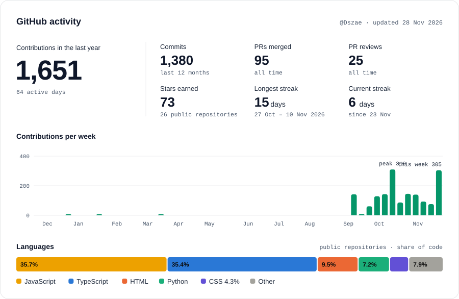

<picture>
  <source media="(prefers-color-scheme: dark)" srcset="assets/hero-dark.svg"/>
  
</picture>

## About

I'm a Computer Engineering student at **IOE Thapathali Campus, Tribhuvan University** in Kathmandu, Nepal. I explore artificial intelligence and machine learning, work with embedded systems and hardware simulation, and have spent more than four years in motion graphics and video editing for over 50 clients worldwide.

- **Studying:** B.E. Computer Engineering, with a focus on digital logic, microcontrollers and circuit analysis.
- **Exploring:** machine learning fundamentals, neural networks and numerical computing in Python.
- **Building:** Windows utilities in C++, After Effects automation and interactive learning tools.
- **Creating:** motion graphics, edits and color for creators and brands.

## Focus areas

<table>
<tr>
<td width="50%" valign="top">

**Computer Engineering and Embedded Systems**

Digital logic, microcontrollers, circuit analysis in Proteus, and low-level Windows tooling.

</td>
<td width="50%" valign="top">

**Artificial Intelligence and Machine Learning**

Learning models from the ground up, and the numerical Python stack that supports them.

</td>
</tr>
<tr>
<td width="50%" valign="top">

**Motion Graphics and Video**

Motion design, editing and color grading, plus tools that automate the slow parts of the workflow.

</td>
<td width="50%" valign="top">

**Interactive Tools**

Learning tools, browser extensions and live-data sites, designed, built and deployed by me.

</td>
</tr>
</table>

## Selected work

<table>
<tr>
<td width="50%" valign="top">

**Systems and embedded**

- **[AltTabs](https://github.com/Dszae/AltTabs)** C++ Keyboard-driven tab switcher HUD for Chromium browsers on Windows, built as a Windhawk mod.
- **[Taskbar Fixer](https://github.com/Dszae/taskbar-fixer)** C++ Hides the Windows 11 taskbar and blocks edge reveal while chosen apps are running.
- **[ESP32 emergency response system](https://www.dipeshsapkota7.com.np/blog/building-an-iot-emergency-response-system-with-esp32-2kgo)** ESP32 · C++ · PCB Prototype for elderly care: motion and biopotential sensing that sends Wi-Fi alerts to caregivers.
- **[555 astable LED flasher](https://www.dipeshsapkota7.com.np/projects/555-flasher)** NE555 · Proteus Breadboard relaxation oscillator with calculated RC timing, simulated in Proteus.

</td>
<td width="50%" valign="top">

**Scientific computing and data**

- **[Invisible Physics](https://github.com/Dszae/interactive-physics-lab)** Python · NumPy Unit-tested field engine and notebooks that visualize electromagnetic fields.
- **[IOE Admission Hub](https://github.com/Dszae/ioe-admission-guide)** TypeScript Rank prediction, campus explorer and priority planning for IOE applicants. [Live](https://ioe-admission.dipeshsapkota7.com.np/)
- **[SEO Crawler](https://github.com/Dszae/Personal-Website-SEO-Crawler)** Python · Streamlit Evidence-based technical SEO audits for sites you control, in a local dashboard.

</td>
</tr>
<tr>
<td width="50%" valign="top">

**Motion and creative tooling**

- **[BeatMarker](https://github.com/Dszae/beatMarker)** JavaScript · CEP After Effects panel that analyzes music and places beat markers on the timeline.
- **[After Effects Downgrader](https://github.com/Dszae/After_effects_downgrade)** JavaScript · Python Rewrites RIFX container versions so newer projects and presets open in older releases. [Live](https://dszae.github.io/After_effects_downgrade/)

</td>
<td width="50%" valign="top">

**Interactive tools**

- **[Git Visualizer](https://github.com/Dszae/git-visualizer)** JavaScript · Canvas Live commit graph, command simulator and guided lessons for learning Git. [Live](https://git-visualizer.dipeshsapkota7.com.np/)
- **[Sportivo](https://github.com/Dszae/sportivo)** TypeScript · Next.js Live scores, fixtures and match discovery for football, cricket and basketball. [Live](https://sportivo.dipeshsapkota7.com.np/)
- **[ShieldFix](https://github.com/Dszae/ShieldFix)** TypeScript · Manifest V3 Privacy-first extension that removes anti-adblock walls with one reversible click.

</td>
</tr>
</table>

If one of these projects helps you, consider starring its repository. It helps others discover the work.

## Writing

<!-- WRITING:START -->
- [Understanding APIs by Building a Real Web Application: Lessons from Sportivo](https://dev.to/dszae/understanding-apis-by-building-a-real-web-application-lessons-from-sportivo-2a7g) 28 Oct 2026 · 7 min read
- [Building BeatMarker: Automating After Effects Beat Detection with JavaScript](https://dev.to/dszae/building-beatmarker-automating-after-effects-beat-detection-with-javascript-344h) 28 Oct 2026 · 3 min read
- [IOE Admission Hub: Building a Rank Predictor and Campus Explorer for Nepal](https://www.dipeshsapkota7.com.np/blog/ioe-admission-hub-building-a-rank-predictor-and-campus-explorer-for-nepal-1n1f) 12 Oct 2026 · 4 min read
- [Building an ESP32-Based IoT Emergency Response System for the Elderly](https://www.dipeshsapkota7.com.np/blog/building-an-iot-emergency-response-system-with-esp32-2kgo) 1 Oct 2026 · 8 min read
- [Building Git Visualizer: Making Git Easier to Understand Through Interactive Visuals](https://www.dipeshsapkota7.com.np/blog/building-an-interactive-git-visualizer-to-master-version-control-4noa) 1 Oct 2026 · 5 min read
<!-- WRITING:END -->

More on [DEV](https://dev.to/dszae), [Hashnode](https://hashnode.com/@dipeshsapkota7) and the [portfolio blog](https://www.dipeshsapkota7.com.np/blog).

## Activity

<picture>
  <source media="(prefers-color-scheme: dark)" srcset="https://raw.githubusercontent.com/Dszae/Dszae/output/stats-dark.svg"/>
  
</picture>

<picture>
  <source media="(prefers-color-scheme: dark)" srcset="https://raw.githubusercontent.com/Dszae/Dszae/output/github-contribution-grid-snake-dark.svg"/>
  
</picture>

Stats and contribution art are generated by this repository's own workflow every four hours.
  

